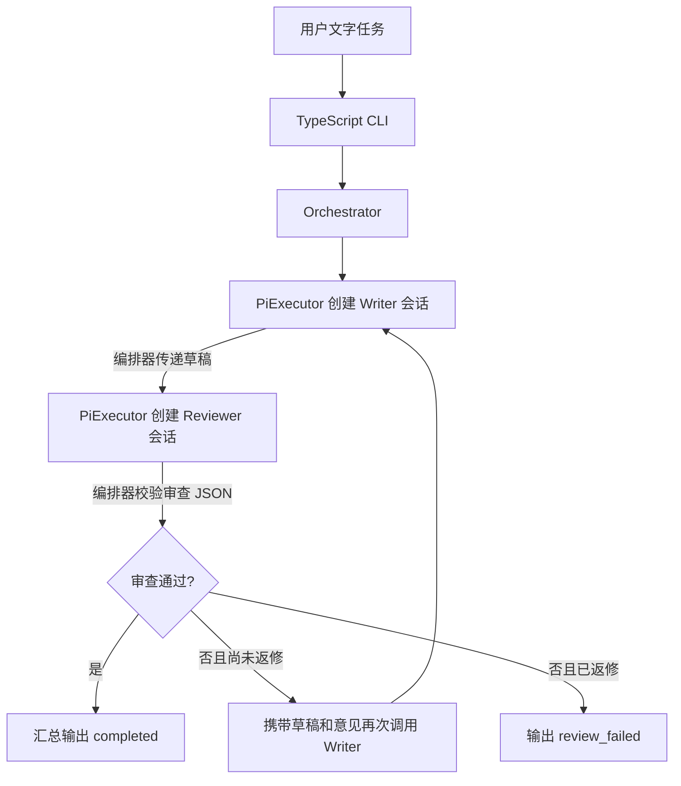

# AgentForge：TypeScript + Pi SDK 编排 MVP

> **状态说明（2026-10-20 复核）**：本文件是迁移前的设计稿，保留完整设计依据。TypeScript MVP 已在 PiWeave 仓库实现（`src/orchestration/`，48 项离线测试通过，真实端点调用验证通过），当前状态与运行方式以 [README.md](README.md) 为准。文中“尚未实现”“待创建”等表述描述的是设计当时的状态。
>
> 新路线采用 TypeScript + Node.js + Pi SDK；原 M0–M10 Python 代码保留为历史学习成果。

## 1. 目标与最小演示

学习如何把 Pi 作为逻辑子执行器，并由自己编写的 Orchestrator 控制角色分工、结果传递、条件分支和一次返修。

MVP 提供一个本地 CLI。用户输入文字任务，TypeScript Orchestrator 依次调用 Writer 和 Reviewer。每次角色调用创建一个独立的 Pi SDK 会话；两个角色可以使用同一个模型，通过固定角色提示与独立上下文区分。

这里的“子执行器”指编排器调用的角色执行单元，不表示独立操作系统子进程。第一版整个程序运行在一个 Node.js 进程中，使用 SDK 方法和事件通信，不启动 Pi CLI 子进程、不维护 RPC 协议。

示例任务：解释 Orchestrator 与执行器的区别，并给出一个简单例子。Writer 生成回答；Reviewer 审查；不通过时，编排器带着旧草稿和意见调用 Writer 返修，最多一次。

**完成标准**：真实调用 Pi SDK 的 Writer/Reviewer 会话，展示结果传递及明确的结束状态；假执行器可确定性验证审查分支和停止条件。

第一版使用纯文本任务，不读取或修改目标项目文件，不创建业务工作区、Git Worktree、候选快照、Docker 或独立验收器。SDK 所需的普通 `cwd` 使用现有项目目录，不建立专门的工作区目录。

## 2. 范围与编排规则

| 本版实现 | 后续有需要再加入 |
|---|---|
| TypeScript CLI 与确定性 Orchestrator | Web、API、数据库、独立 Worker |
| Writer、Reviewer 两个 Pi 角色 | Planner、动态拆分、DAG、多执行器选择 |
| 串行调用、最多一次返修、超时与中断 | 并行、恢复、独立进程隔离 |
| stderr 进度与 stdout 最终 JSON | 长期运行记录、Diff、测试报告 |
| 假执行器测试与真实 SDK 演示 | 多 Provider 对照、复杂评测平台 |

第一版的流程直接写在 TypeScript 中。模型提供草稿和审查数据，程序决定下一步；不执行模型输出的代码、命令或流程定义。

一次直接通过需要两次角色调用；一次返修最多四次：Writer → Reviewer → Writer → Reviewer。角色调用不共享会话历史，所有业务上下文通过明确参数传递。返修后的 Reviewer 必须收到新草稿。

## 3. 技术栈、环境和选型

| 部分 | 技术 | 用途 |
|---|---|---|
| 运行环境 | Node.js 24.x、npm | 运行 CLI、管理依赖和生命周期 |
| 源码 | TypeScript、ESM、strict | 类型契约、流程、状态与结果 |
| 子执行器 | `@earendil-works/pi-coding-agent` SDK | 创建角色会话、调用模型、接收事件、中止与释放资源 |
| 开发与构建 | `tsx`、`typescript`、`@types/node` | 开发时运行 TS、类型检查与编译 |
| 验证 | Node.js 内置 `node:test`、`node:assert/strict` | 契约、编排、适配器和 CLI 测试 |

选择进程内 SDK，可以直接使用 Pi 的 TypeScript 类型和方法，将学习重点放在编排。Python RPC 方案中的 JSONL 分帧、请求 ID、stdin/stdout 协议及 Windows CLI 包装器处理不再属于本版职责。[Pi SDK 文档](https://github.com/earendil-works/pi/blob/main/packages/coding-agent/docs/sdk.md)

本次核对 Node.js 返回 `v24.18.0`。上游包清单当前声明 Node.js `>=22.19.0`、ESM 和 SDK 包名；上游版本信息仅作为设计参考。实施时核对实际可安装版本，固定 SDK 版本并提交 `package-lock.json`，后续用 `npm ci` 重建，不直接依赖漂移的 `main`。[Pi 包清单](https://github.com/earendil-works/pi/blob/main/packages/coding-agent/package.json)

设计当时仓库尚无新 MVP 的 `package.json`、TypeScript 配置和源码模块；现在这些均已实现。运行依赖 npm SDK，不使用全局 `pi` CLI，也不使用 Pi 账号登录——端点、API Key 与模型由 `PIWEAVE_BASE_URL` / `PIWEAVE_API_KEY` / `PIWEAVE_MODEL` 提供。

## 4. 架构与职责



两个角色使用同一个 `PiExecutor` 类；每次调用创建新的 SDK 会话，在调用结束后释放。Pi 会话不直接互相发消息。Writer → Reviewer 的传参、返修次数和停止决定全部由 Orchestrator 控制。

| 组成 | 输入 | 职责与输出 |
|---|---|---|
| CLI | 文字任务、宿主配置 | 校验参数；stderr 输出进度；stdout 输出一个最终 JSON |
| Orchestrator | 任务、执行器接口 | 顺序调度、保存草稿和意见、控制次数与剩余时间 |
| PiExecutor | 角色请求、时间与取消信号 | 创建并配置 SDK 会话，把事件和输出转换为统一结果 |
| Writer | 原任务；返修时另带旧草稿和意见 | 输出完整文字答案 |
| Reviewer | 原任务与本轮草稿 | 只输出审查 JSON，后续流程由程序决定 |

## 5. 目标目录与构建方式

以下为目标目录结构。当前实现已完成 `package.json`、`tsconfig*.json`、`src/orchestration/` 与 `tests/*.test.ts`；`src/agentforge/`、`tests/unit/`、`tests/integration/` 属于历史 Python 项目，不在本仓库：

```text
AgentForge/
├─ package.json                    新 TS MVP 的依赖、脚本与 ESM 声明
├─ package-lock.json               实施安装后生成并提交的依赖锁
├─ tsconfig.json                   NodeNext、strict 与输出目录
├─ src/
│  ├─ orchestration/               新 TS 编排功能
│  │  ├─ model.ts                 请求、执行结果、审查结果和运行结果
│  │  ├─ executor.ts              Executor 接口与 PiExecutor
│  │  ├─ prompts.ts               固定角色提示与业务数据拼装
│  │  ├─ service.ts               Orchestrator 顺序、分支、次数和时间
│  │  └─ cli.ts                   CLI 输入、进度和最终 JSON
│  └─ agentforge/                 已有 Python 历史实现，原位保留
└─ tests/
   ├─ orchestration.test.ts        确定性流程、上下文传递和停止条件
   ├─ executor.test.ts             SDK 会话替身与生命周期测试
   ├─ cli.test.ts                  CLI 输入输出和退出码
   ├─ unit/                       既有 Python 测试
   └─ integration/                既有 Docker 测试
```

新模块独立于旧 Python 入口，不通过 Python 启动 Node，也不重写旧模块。角色提示和专属适配器集中在 `orchestration/`；暂不建立 Agent 注册中心、通用插件层或独立角色目录。

`package.json` 计划设置 `type: module`；`tsconfig.json` 使用 `module/moduleResolution: NodeNext`、`strict: true`、`target: ES2022`，仅编译 `src/orchestration/` 到 `dist/`。ESM 相对导入按 NodeNext 约定使用 `.js` 后缀；开发环境由 `tsx` 运行 TS。

实际提供的脚本：

| 命令 | 目标行为 |
|---|---|
| `npm run dev -- run "文字任务"` | 使用 tsx 运行 `src/orchestration/cli.ts` |
| `npm run check` | `tsc --noEmit`，检查类型 |
| `npm test` | 用 tsx 支持的 Node 内置测试运行器执行四个 `.test.ts` |
| `npm run build` | `tsc` 编译正式 JS 入口 |
| `node dist/cli.js run "文字任务"` | 运行编译后的 CLI |
| `npm run verify:sdk` | 一次真实 Writer 调用，验证端点、模型与认证 |

正式测试脚本明确列出四个测试文件，避免不同 Shell 的通配符差异。旧 Python 的 `pytest` 和 Ruff 保持原用途，不用于证明 TS 已验证。

## 6. 最小类型契约与模型输出校验

以下为设计接口，不是已经实现的模块：

```typescript
export type Role = "writer" | "reviewer";

export interface AgentRequest {
  role: Role;
  task: string;
  draft?: string;
  feedback?: readonly string[];
}

export interface Usage {
  inputTokens: number | null;
  outputTokens: number | null;
  cost: number | null;
}

export interface AgentResult {
  status: "completed" | "failed" | "timed_out" | "cancelled";
  text: string;
  error: string | null;
  usage: Usage | null;
}

export interface Executor {
  execute(
    request: AgentRequest,
    options: { timeoutMs: number; signal?: AbortSignal },
  ): Promise<AgentResult>;
}

export interface Review {
  approved: boolean;
  feedback: string[];
}
```

Orchestrator 仅依赖 `Executor`，测试时可注入假执行器。SDK 的事件和异常留在 PiExecutor 边界，不传播到业务调度代码。

Reviewer 输出完整 JSON，例如：

```json
{"approved": false, "feedback": ["缺少一个具体的任务分配例子"]}
```

用 `JSON.parse` 得到 `unknown`，再显式检查 `approved` 为布尔值、`feedback` 为字符串数组（最多 20 条）；未知字段忽略。不通过时意见必须非空；通过时意见可为空，也可携带非阻塞建议。字符串 `"false"`、Markdown 代码块、字段缺失或类型错误均归入 `execution_failed`，不新增模型修复调用。

TypeScript 接口和 `as Review` 断言不能验证外部数据。第一版用少量明确的运行时检查即可，不为一个结构引入通用 Schema 框架。

## 7. Pi SDK 会话适配的实现说明

### 7.1 会话配置

每次 `execute` 新建会话；由宿主显式选择 Provider 和模型，Writer/Reviewer 可共用同一模型配置。模型访问固定走本项目的 OpenAI 兼容端点，端点地址、API Key 与模型 ID 由 `PIWEAVE_BASE_URL` / `PIWEAVE_API_KEY` / `PIWEAVE_MODEL` 提供（本地 `.env` 或环境变量），源码内不保存默认值：启动时以固定的 `piweave-local` 名称注册到模型运行时，API Key 随 Provider 配置传入，模型运行时也不加载用户级 `models.json`，因此不使用 Pi 的 OAuth 登录或订阅凭据。程序不另写 Provider HTTP 客户端，也不输出凭据。

会话配置目标：

- 通过 `createAgentSession` 创建会话，使用 `SessionManager.inMemory()` 保存本次对话，不落盘会话记录。
- 使用内存 SettingsManager，关闭自动重试和压缩，保持本次小任务的行为简单；宿主仍控制总时间。
- 显式关闭工具，不注册自定义工具或 MCP；本版只生成文字。
- 提供应用控制的 ResourceLoader，固定角色 system prompt，返回空的扩展、技能、模板和上下文文件资源；不自动发现本机或项目的指令文件。
- 普通 `cwd` 使用已有项目目录。没有业务工作区，也不因为创建会话而创建项目目录。

这些配置依据 SDK 的 [会话与设置接口](https://github.com/earendil-works/pi/blob/main/packages/coding-agent/docs/sdk.md)、[内存设置示例](https://github.com/earendil-works/pi/blob/main/packages/coding-agent/examples/sdk/10-settings.ts) 与 [完整资源控制示例](https://github.com/earendil-works/pi/blob/main/packages/coding-agent/examples/sdk/12-full-control.ts)。实现时以安装版本的类型声明校验具体参数，不将旧 CLI 开关直接传给 SDK。

### 7.2 一次角色调用

1. 建立本次调用的时间与取消控制，创建独立会话。
2. 在请求前通过 `session.subscribe` 订阅事件。进度只写 stderr；保存最终 assistant 消息，避免把流式片段当成完整回答。
3. 调用 `session.prompt` 发送业务正文；角色规则固定在 system prompt 中，任务、旧草稿和意见按 JSON 数据拼装。
4. 等待本次 `prompt` 完成；SDK 会处理内部运行循环。不要用第一次 `agent_end` 提前宣告完成。
5. 检查本次调用未超时或取消，最终 assistant 正常结束；错误、取消或输出截断不归为完成。用 `session.getLastAssistantText()` 取非空结果，再限制文本大小，例如最多 12,000 字符，超限直接返回明确失败。
6. 如该版本提供会话/消息用量则归一化到 Usage；未知字段为 null，不记成零，也不声称具有费用硬上限。
7. 在 `finally` 中取消订阅、清除计时器和信号监听，并调用 `session.dispose()`。本次调用全部收尾后再执行下一个角色。

`prompt`、事件订阅、读取输出、`abort` 和 `dispose` 的职责见 [官方 SDK 生命周期说明](https://github.com/earendil-works/pi/blob/main/packages/coding-agent/docs/sdk.md)。

### 7.3 超时和用户中断

默认每次角色调用 60 秒、整次任务 240 秒、最多一次返修。使用 `performance.now()` 计算剩余时间；每次执行传入 `min(60秒, 剩余总时间)`，会话创建、模型请求和正常收尾均计入调用时间。

超时或 Ctrl+C 时，停止启动新角色，并调用当前会话的 `abort()`，随后释放会话。不能只用 `Promise.race` 停止等待，却让底层调用继续运行；应处理未完成 Promise 的最终结果，避免未处理异常。

清理额外等待最多 5 秒。若 SDK 在同一进程内无法按期停止，CLI 输出明确的错误/超时结果，完成输出写入后结束本次 Node.js 进程，不继续使用该会话。此设计没有独立子进程的强制终止边界；以后确有进程隔离需求时再引入 Pi RpcClient。

本版限制角色调用次数和应用计时，不承诺严格的 CPU、token 或费用硬上限。

## 8. 编排、状态与输出

```text
draft = 调用 Writer(原任务)
review = 调用 Reviewer(原任务, draft)，并校验 JSON
若通过：输出 completed
否则：
    draft = 调用 Writer(原任务, draft, review.feedback)
    review = 调用 Reviewer(原任务, 新 draft)，并再次校验
    通过则输出 completed，否则输出 review_failed
任一执行错误、超时或取消：停止下游，输出对应状态
```

不做自动技术重试；唯一业务返修路径是审查不通过后重新写一次。模型不能直接更新 Orchestrator 的结束状态。

最终 JSON 至少包含 `runId`、`task`、`status`、`draft`、`review`、`attempts`、`elapsedMs`、`error`。attempts 按顺序记录角色、执行状态、耗时和可用用量；失败时保留已得到的草稿与意见。

| 最终状态 | 含义 | CLI 退出码 |
|---|---|---|
| `completed` | 流程完成，最后一次 Reviewer 判断通过 | 0 |
| `review_failed` | 已返修一次，Reviewer 仍不通过 | 1 |
| `execution_failed` | SDK/模型错误、空或超限输出、非法审查 JSON | 2 |
| `timed_out` | 单次调用或总时间耗尽 | 124 |
| `cancelled` | 用户中断，已执行取消和收尾 | 130 |

completed 仅说明流程完成并获模型审查通过，不等同于客观正确或软件测试通过。本版没有独立测试验收器；真实模型不保证每次通过 Reviewer。

## 9. 与历史项目的关系及当前状态

- 新 TS 入口不导入旧 Python 模块，不调用工作区、Docker、M9 验收或 M10 报告。
- 默认只在内存保存本轮数据，进度写 stderr，结果写 stdout；不使用 `.local/workspaces/` 或自动生成运行目录。
- 旧 Python 源码、测试和本机数据保留在历史仓库；旧说明（`最终目标.md`、`阶段目标.md`）不包含在本仓库中。
- 当前实施顺序见 [阶段步骤实现.md](阶段步骤实现.md)，入口说明见 [README.md](README.md)。

本文件记录的是设计阶段的状态。MVP 的 P1–P4 已在 PiWeave 仓库实现并通过验证，最新验收记录见 [README.md](README.md)。
